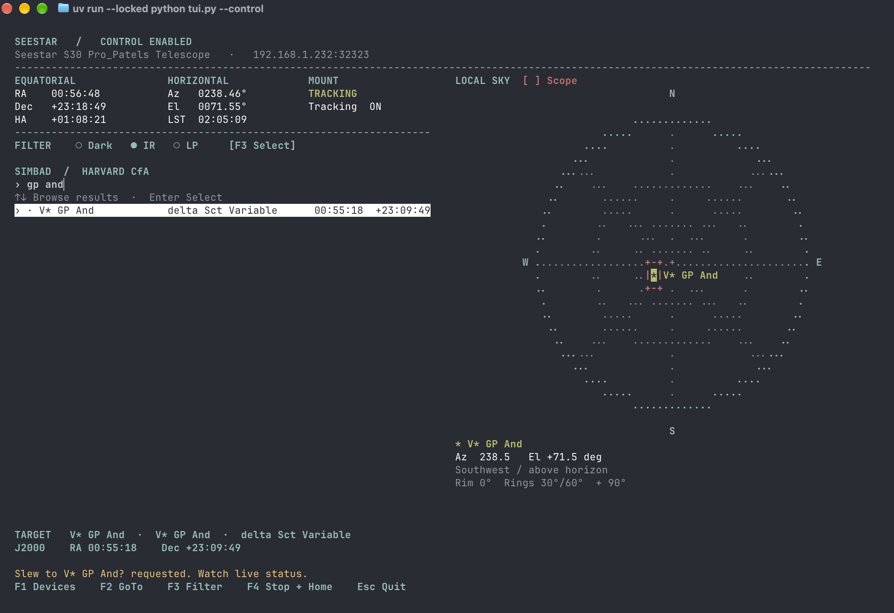
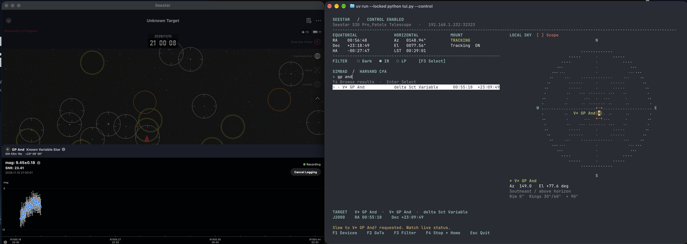

# Seestar TUI

Seestar TUI is a Python terminal app for finding astronomical targets, checking where they are in your local sky, and pointing a Seestar telescope at them over your local network.

- **Connect and monitor.** Discover Seestar telescopes via ASCOM Alpaca and see live pointing, tracking, and filter status.
- **Find and preview targets.** Search Harvard CfA’s SIMBAD catalogue by name or identifier, including variable stars such as GP And. Compare the selected target with the telescope’s current pointing on a live sky chart.
- **Control the telescope.** Enable control mode to slew to a target, change filters, or stop Alpaca activity and return the mount home.
- **Choose how to observe.** Use read-only mode to monitor the scope alongside the native Seestar app during photometry, or try the demo without a telescope.

## Screenshots



*The TUI tracking GP And. The red rectangle marks the telescope’s pointing.*



*The TUI displays the pointing while the native Seestar app records photometry.*

## Install

For a live connection, enable **Alpaca** in the connected Seestar app under **Me → Device Management → Assistive Features → Alpaca**.

Install [uv](https://docs.astral.sh/uv/getting-started/installation/) and use a terminal at least 75 columns by 25 rows. Clone the repository and install the locked dependencies with these commands.

```sh
git clone https://github.com/rishipat/seestar-tui.git
cd seestar-tui
uv sync --locked
uv run --locked python tui.py --demo
uv run --locked python tui.py
```

The demo uses an in-memory telescope and sample catalogue. The default live mode only reads device data. If the LAN does not pass discovery broadcasts, add a known address with `--host 192.168.1.100`. The default HTTP port for a supplied address is 32323. On macOS, permit your terminal to access the local network if the OS prompts.

When the scope is set up outdoors and ready to move, use `uv run --locked python tui.py --control`. Commands require an explicit confirmation in the dashboard.

| Key | Action |
| --- | --- |
| ↑ / ↓, Enter | Select the telescope or select a SIMBAD result |
| Type, Backspace, Ctrl+U | Search Harvard CfA SIMBAD by identifier prefix, edit, or clear |
| F1 or Ctrl+R | Discover devices again |
| F2 or Ctrl+G | GoTo selected target |
| F3 or Ctrl+F | Choose a filter from the driver's list |
| F4 or Ctrl+O | Abort Alpaca slew and active Alpaca exposures, then request FindHome |
| Esc | Back, cancel, or quit |

Live status reads mount RA and Dec, azimuth, altitude, sidereal time and filter position. Hour angle is local apparent sidereal time minus mount RA, wrapped into ±12 hours, for the Seestar's topocentric frame. The UI stays responsive while catalogue and device requests run. A dash means the driver did not provide that measurement.

At 109 columns or wider, **Local Sky** shows the horizon as a circle and marks overhead with `+`. North is up and east is right. An above-horizon target appears as `*`. A below-horizon target appears as `v` on the rim in the target's compass direction, with its actual negative elevation shown below the plot. Astropy recalculates the position every five seconds using the Seestar's observing site and the computer's clock. The simulator uses a fixed site in Berkeley.

A red rectangle marks the telescope’s current pointing. When the telescope points below the horizon, the rectangle appears on the rim at its reported azimuth.

The faint inner rings mark 30° and 60° elevation, and the spokes mark every 45° of azimuth.

Catalogue rows show the SIMBAD main ID, object type and J2000 coordinates. The selected target also shows the matched alias. GoTo reads the driver's frame and site, uses Astropy to convert J2000 to topocentric apparent RA/Dec when required, checks altitude, then sends an asynchronous slew. The pointing calculation omits atmospheric refraction and proper motion.

Stop + Home operates on activity Alpaca can see. Stop native-app photometry, stacking or planned shooting in the app before handing over control. FindHome uses the driver's home operation and does not request Park. A parked scope must be deliberately unparked before GoTo or FindHome.
